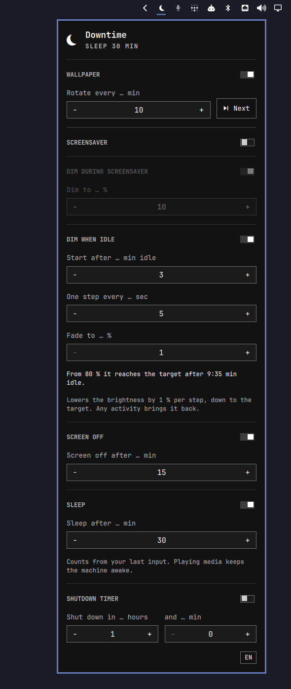

# Downtime 💤

Screensaver, screen dimming, gradual dimming when idle, screen off, sleep, a shutdown timer and wallpaper rotation for [Omarchy](https://omarchy.org/), set from one bar widget.

<p align="center">
  
</p>

Omarchy can start a screensaver and lock on idle out of the box. Downtime adds the steps around that: fade the screen down while you are away, turn it off, put the machine to sleep, or shut it down at a set time.

An independent [MIT](LICENSE)-licensed plugin. Not affiliated with or endorsed by 37signals.

## What it does

The panel shows one row per setting with its current value and a small on/off switch. Click a row to open its settings below it; one opens at a time, so the panel stays short. The minutes are kept while a setting is off.

| Setting | Default | Notes |
| --- | --- | --- |
| Wallpaper rotation | off, 10 min | Calls `omarchy-theme-bg-next`. Right-click the widget for the next one. |
| Screensaver | unchanged | Omarchy's own `idle.screensaver` and screensaver toggle. Left exactly as they are until you change them in the widget. |
| Dim during screensaver | off, 40 % | Lowers every display to this brightness while the screensaver runs and restores it afterwards. |
| Dim when idle | off, after 3 min, 1 % every 5 s, down to 50 % | Fades every display down step by step while you are idle. Any input brings the brightness back. The panel shows when the target is reached. |
| Screen off | 10 min | Turns the displays off with Hyprland's DPMS. Separate time on battery. |
| Sleep | off, 30 min | Via `systemctl suspend`. Separate time on battery. |
| Shutdown timer | off, 1 h | One-shot, in hours and minutes. Follows the clock, not idle time, and powers off with `systemctl poweroff`. |

Things worth knowing:

- **Times count from when the screensaver starts.** Opening the screensaver resets the idle clock. With screensaver 5 and sleep 30, the machine sleeps after about 35 minutes. Without a screensaver they count from your last input, and so does dimming when idle.
- **Dimming when idle hands over to the screensaver.** The fade starts before the screensaver; once it opens, the screensaver's own dimming takes over and never lifts the brightness back up. The panel says how long the fade takes from the current brightness, or how far it gets before the screensaver or screen off cuts in. A start time no earlier than the screensaver gets a warning, because the fade would never show.
- **Screen off and sleep have their own times on battery.** On a machine with a battery, both sections show a row for AC and one for battery, each with its own switch and minutes, for example sleep only on battery. Until you change the battery row, it follows the AC one. The times switch over as soon as the power cable is plugged in or pulled, and the idle clock starts over. Without a battery there is only the one time.
- **Stay Awake is respected.** While Omarchy's Stay Awake is on, there is no dimming when idle, no screen off and no sleep. The panel says so.
- **Playing media keeps the machine awake.** Inhibitors from browsers and video players are respected.
- **The screensaver is closed before Downtime puts the machine to sleep**, so you wake up to your desktop, not to the screensaver. Displays turned off before sleep come back on after waking up.
- **The shutdown timer is one-shot.** The switch starts the countdown and cancels it. A notification confirms the time, and another one comes one minute before. If the machine is asleep when the time comes, the shutdown is skipped on wake with a notification instead of powering off right away. Sleep is paused and greyed out while it runs, because a sleeping machine would never shut down. The timer survives a shell restart and is cancelled when the plugin is disabled or removed. The chosen time is kept for next time.
- **Dimming needs a display whose brightness Omarchy can set.** It uses `omarchy-brightness-display`, the same path as the brightness keys: the backlight on laptops, DDC/CI on external monitors. If no display can be dimmed, both dimming sections are left out of the panel. On a monitor, DDC/CI may have to be turned on in its own menu. If your brightness keys work, dimming works too.
- **Brightness always comes back.** Each change is read back and retried, displays still waking up from screen off are waited for (even monitors that vanish for a moment while they wake up), and anything left dimmed without a screensaver is restored within seconds. Displays already darker than the target are left alone. A display that turns off while dimmed stays dimmed until you are back, so it never flashes bright right before going dark.
- **Numbers are set with − and +.** Hold a button to count faster, or use the mouse wheel or the arrow keys. There is no text field, so the panel never reads the clipboard.
- **Locking is not changed.** Omarchy still locks the screen before sleep. If you do not want a password after wake, see [Sleep without a password](#sleep-without-a-password).

## Install

```sh
omarchy plugin add https://github.com/heast13/omarchy-downtime.git --enable
```

> [!IMPORTANT]
> Plugins run as unsandboxed code inside `omarchy-shell`. Only add repos you trust, and read the source before you enable one.

## Update

```sh
omarchy plugin update heast13.downtime
omarchy restart shell
```

Restart the shell after an update. A running shell can keep the old version of the plugin's background service loaded.

## How it works

- `Service.qml` reads the widget's settings straight from `~/.config/omarchy/shell.json` and runs `scripts/apply` whenever a timing changes, and once at login.
- Enabling the plugin changes none of your settings. That is why the screensaver switch and delay are missing from the `defaults` in `manifest.json` on purpose: a setting that was never touched is left to Omarchy (`keep`), a default would overwrite it. The screensaver stays as it is until you change it in the widget.
- `scripts/apply` takes exactly seven values and refuses anything else, so a mismatched or half-updated caller changes nothing.
- `scripts/shutdown` runs the shutdown timer as the transient user units `downtime-shutdown.timer` and `downtime-shutdown-warn.timer` on the wall clock, and keeps its deadline in `~/.local/state/downtime/shutdown-at`.
- Screen off, sleep and dimming when idle are timed in `Service.qml` itself, with the same Wayland idle timers Omarchy uses for its screensaver and lock. No extra program is needed, and a `hypridle` of your own is left alone.
- `scripts/dim` saves each display's brightness in `~/.local/state/downtime/dim-saved` while the screensaver runs or the idle fade is on. The service watches Hyprland for the screensaver's windows. The idle fade runs as the transient user unit `downtime-fade.service`.
- Disabling or removing the plugin stops that unit and restores dimmed displays.

If you also run a `hypridle` of your own with screen-off or sleep timers (for example from `~/.config/hypr/autostart.lua`), both act side by side. Turn those timings off in one of them.

## Language

The UI follows the system locale and falls back to English. Click the **EN** / **DE** button at the bottom right of the panel to switch. From a terminal:

```sh
omarchy bar set heast13.downtime language de
```

`en`, `de` or `auto` (the default).

## Sleep without a password

Omarchy locks the screen right before sleep with the user unit `omarchy-sleep-lock.service`. On a desktop nobody else uses, you can turn that off:

```sh
systemctl --user mask --now omarchy-sleep-lock.service
```

Undo:

```sh
systemctl --user unmask omarchy-sleep-lock.service
systemctl --user enable --now omarchy-sleep-lock.service
```

Only do this on a machine you trust everyone around.

## Uninstall

```sh
omarchy plugin remove heast13.downtime
rm -rf ~/.local/state/downtime
```

The screensaver delay stays at the last value. Change it back in `~/.config/omarchy/shell.json` under `idle.screensaver` if you like.

## License

[MIT](LICENSE)
